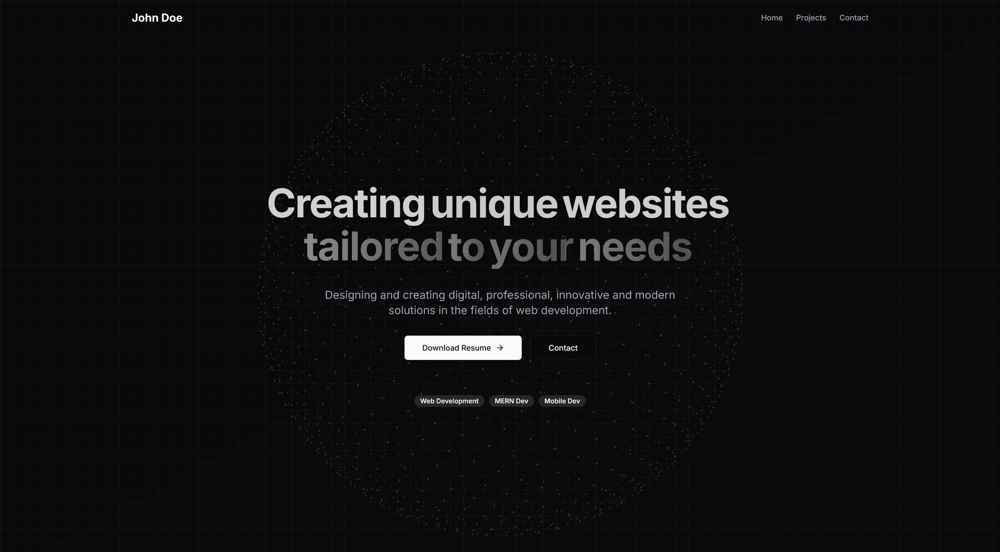

# Dark React Developer Bundle

A modern, dark-themed developer portfolio template built with Next.js 14, TypeScript, Tailwind CSS, and shadcn/ui. Designed pages are included — edit content in config and JSON, then deploy.

**Live demo:** [dark-react-developer-bundle.vercel.app](https://dark-react-developer-bundle.vercel.app/)




---

## What's inside

- **Routes**: Home (`/`), `/projects`, `/projects/[slug]`, `/contact`
- **Home sections**: Hero with dotted globe, About (accordion + metrics), Services, Featured Projects, Site Footer with CTA
- **Projects page**: Category + tech filters, card grid, image lightbox
- **Project detail pages**: Dynamic `/projects/[slug]` with highlights, impact, and screenshots
- **Contact page**: Availability copy and a message form (UI-only until you wire a provider)
- **Global chrome**: Navbar + footer from `config/site.ts`
- **Content workflow**: Branding in `config/site.ts`, projects in `data/projects.json`
- **No backend, no database, no env vars required**

---

## Quick start

```bash
npm install
npm run dev
```

Open <http://localhost:3000>.

```bash
npm run build
npm run start
```

---

## How to edit your portfolio

1. **Edit `config/site.ts`** — name, role, email, social links, nav
2. **Edit `data/projects.json`** — add, edit, or remove projects
3. **Swap images in `public/`** — project covers, screenshots, favicons
4. **Run `npm run dev`** to preview
5. **`git commit` and `git push`** — your host redeploys

No CMS, no database, no admin login.

### Project schema

Required: `id`, `slug`, `title`, `description`, `category`, `tech`, `completed`.

Optional: `featured`, `status`, `client`, `duration`, `completionDate`, `websiteUrl`, `githubUrl`, `tags`, `highlights`, `impact`, `coverImage`, `screenshots`.

Enums:

- `category`: `"creative" | "real-estate" | "corporate"`
- `tech`: `"wordpress" | "react" | "nextjs" | "php"`
- `status`: `"published"` (default) or `"draft"` (hidden)

Mark `"featured": true` for the homepage strip (first 3 featured, or first 3 published if none are featured).

Full schema: top of `lib/projects-data.ts`.

---

## Where to edit

| What you want to change | File |
| ----------------------- | ---- |
| Site name, role, email, social | `config/site.ts` |
| Page title & meta description | `config/site.ts` (via layout) |
| Hero headline, subheadline, CTAs, badges | `components/home-page-client.tsx` |
| About intro & accordion | `components/sections/about-section.tsx` |
| Services section | `components/sections/services-section.tsx` |
| Featured projects strip | `data/projects.json` (`featured: true`) |
| Contact availability & form note | `components/sections/contact-section.tsx` |
| Projects (every page) | `data/projects.json` |
| Project cover / screenshot images | `public/` |
| Theme colors | `app/globals.css` |

See `CUSTOMIZATION.md` for details.

---

## Project structure

```
dark-react-developer-bundle/
├── app/
│   ├── globals.css
│   ├── layout.tsx
│   ├── page.tsx                 # home → hero, about, services, featured
│   ├── contact/page.tsx
│   └── projects/
│       ├── page.tsx             # filterable project list
│       └── [slug]/page.tsx      # project detail
├── components/
│   ├── home-page-client.tsx
│   ├── site-navbar.tsx
│   ├── site-footer.tsx
│   ├── hero-title-with-globe.tsx
│   ├── dotted-globe.tsx
│   ├── motion/                  # animated section titles
│   ├── projects/                # filter + lightbox
│   ├── sections/                # about, services, featured, contact
│   └── ui/                      # shadcn primitives
├── config/site.ts
├── data/
│   ├── projects.json            # YOUR PORTFOLIO CONTENT
│   └── globe.json               # globe geometry (do not edit)
├── lib/projects-data.ts
├── public/                      # site assets
└── images/                      # README preview screenshots
```

---

## Documentation

| File | Purpose |
| ---- | ------- |
| `QUICK-START.md` | 15-minute setup checklist |
| `CUSTOMIZATION.md` | File-by-file edit guide |
| `DEPLOYMENT.md` | Vercel-first deploy guide |
| `AI_CUSTOMIZATION_PROMPT.md` | Copy-paste AI prompt |
| `LICENSE.md` | MIT — free to use, share, and fork |

---

## License

This project is free and open source under the [MIT License](LICENSE.md). Clone it, customize it, publish it publicly, and use it for personal or commercial work.
